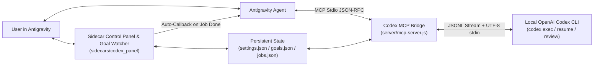

<div align="center">


# Codex Bridge

**An Antigravity plugin with an interactive control panel, persistent goal & milestone board, auto-callback progression loop, and zero-dependency MCP bridge to orchestrate your local OpenAI Codex CLI.**

[](./plugin.json)
[](https://nodejs.org/)
[](#architecture)
[](https://modelcontextprotocol.io/)
[](./LICENSE)

**English** · [简体中文](./README.zh-CN.md)

</div>

---

## Why Codex Bridge?

**Codex Bridge** turns your local **OpenAI Codex CLI** into a persistent, goal-driven coding & analysis worker inside **Google Antigravity** — built specifically for iterative workflows like **backend debugging/refactoring** and **meta-analysis / data pipelines** that require continuous investigation, execution, and verification.

- Let **Antigravity** analyze requirements, design verifiable milestones, inspect diffs, and verify outcomes.
- Let **Codex** execute edits, run backend tests/scripts, resume multi-turn sessions, and wake Antigravity automatically when background runs finish.

## Features

- **Mastermind + Worker Role Division (`orchestrator` / `flexible`)** — Defaults to **Mastermind Mode**: Antigravity leverages its strengths in text synthesis, specification writing, lightweight tools/plugins, and stage verification, while delegating all heavy coding, backend debugging, and data/meta-analysis script execution to Codex in a closed callback loop (`codex_start` with `conversation_id`).
- **Native Interactive Sidecar Panel (EN / 中文)** — Appears right inside Antigravity's **Plugins** side-pane menu with one-click live **English / Chinese** switching and two clean tabs (**Controls** & **Goals & Jobs**):
  - **Model selection** (auto-populated from your local `~/.codex/models_cache.json`)
  - **Reasoning effort** (dynamically adapts to each model's supported levels: `low`, `medium`, `high`, `xhigh`, `max`, `ultra`)
  - **Progression mode** (switchable live):
    - `manual` — No automatic callbacks; wait for your next prompt.
    - `notify` — Automatically wakes Antigravity when a background Codex job finishes so it can verify and report findings.
    - `autonomous` — Automatically verifies completed milestones, calls `codex_resume` on failure, or advances to the next pending milestone until done (guarded by a configurable `maxAutoIterations` cap and one-click **Pause** button).
  - **Sandbox policy** (`read-only`, `workspace-write`, `danger-full-access`) & **Briefing workflow** (`direct` vs. `plan_first`)
- **Persistent Goal & Milestone State Machine** — Goals, ordered milestones, verification commands, blockers, and linked `Session ID`s persist on disk (`goals.json`), surviving conversation compaction and restarts.
- **Per-Job Locked Callbacks & Explicit Retry** — Callback targets (`conversationId` / `projectId`) are locked from trusted Antigravity host context at job dispatch time (`GET /api/state` is strictly read-only, preventing cross-conversation leaks). Failed deliveries remain visibly marked `failed` with one-click retry strictly to the original source conversation.
- **Restart-Resilient Jobs & Cross-Process Session Locks** — Background jobs (`codex_start`) persist to `jobs.json` with atomic per-session file locks (`locks/`). If the MCP server restarts while a Codex process is still alive, the job transitions to `running_detached` (blocking duplicate spawns until it finishes or is explicitly stopped). Structured resume (`resume_job_id` or panel **Resume Job**) preserves original `session_id`, `cwd`, `sandbox`, `goal_id`, and `milestone_id`, places `-C` / `-s` before `resume`, and blocks accidental sandbox widening unless explicitly confirmed.
- **Automatic Codex Discovery** — Automatically locates the newest `codex.exe` bundled with Codex Desktop on Windows (survives hash-folder auto-updates), falls back to `codex` on `PATH`, or respects `CODEX_BIN`.
- **Zero External Dependencies** — Pure Node.js ESM (`>= 18`). No `npm install`, no build step, instant startup, UTF-8 `stdin` prompting.

## Architecture



## Quick Start

### Prerequisites

- **Google Antigravity** (Desktop or CLI)
- **Node.js `>= 18`**
- **OpenAI Codex** (Codex Desktop app or `codex` CLI installed and signed in)

### Install

**macOS / Linux:**
```bash
git clone https://github.com/yeyuhants-prog/codex-bridge.git ~/.gemini/config/plugins/codex-bridge
```

**Windows (PowerShell):**
```powershell
git clone https://github.com/yeyuhants-prog/codex-bridge.git "$env:USERPROFILE\.gemini\config\plugins\codex-bridge"
```

### Enable & Open the Panel

1. Open **Skills & Customizations** (自定义扩展) in Antigravity's left sidebar and ensure **Codex Bridge** is toggled **ON**.
2. Open the interactive control panel from the right-hand **Plugins** (`插件`) menu → **Codex Bridge**.
3. Pick your **Codex model**, **reasoning effort**, **progression mode** (`manual` / `notify` / `autonomous`), and **sandbox** — each new job binds its callback when dispatched. Conflicting request and host conversation IDs are rejected.

## MCP Tools (9)

| Tool | Description |
| --- | --- |
| `codex_goal` | Create, inspect, update milestones, pause/resume, or delete persistent multi-step Goals shared with the Sidecar goal board. |
| `codex_run` | Run a task synchronously via `codex exec` using active panel settings (or per-call overrides). Supports optional `goal_id` & `milestone_id`. |
| `codex_resume` | Continue by `resume_job_id` or an exact session UUID. Unknown sessions default to read-only. |
| `codex_review` | Run Codex's built-in non-interactive Git code review (`uncommitted`, `base` branch, or `commit` SHA). |
| `codex_start` | Launch a persistent background Codex worker and return `job_id` immediately; triggers auto-callback upon completion in `notify`/`autonomous` modes. |
| `codex_status` | Inspect progress events, `Session ID`, or final output of a background job (including restart-interrupted jobs), with optional `wait_seconds` long-polling. |
| `codex_cancel` | Terminate a running background Codex job along with its child process tree. |
| `codex_config` | Read or update shared preferences (`model`, `reasoning_effort`, `sandbox`, `workflow_mode`, `progression_mode`, `max_auto_iterations`) and list local Codex models. |
| `codex_info` | Health check showing resolved Codex binary & version, active panel settings, bound conversation, active goal progress, and tracked jobs. |

## Example Prompts

- **Continuous backend debugging:**
  > *"Create a persistent Codex Bridge goal to reproduce the 500 error in `backend/auth`, fix the root cause, and pass `pytest`. Start milestone 1 in the background and keep verifying until all tests pass."*
- **Iterative meta-analysis pipeline:**
  > *"Set up a goal with milestones for cleaning the dataset, checking heterogeneity (I² / Q-test), running sensitivity analysis, and exporting forest plots. Dispatch Codex step-by-step and verify each output table."*
- **Code review:**
  > *"Have Codex review my uncommitted Git changes in this repository and summarize bugs or edge cases."*
- **Per-call model override:**
  > *"Use `gpt-6.2-astra` with `xhigh` reasoning effort and have Codex refactor the parser module."*

## Environment Variables

| Variable | Default | Purpose |
| --- | --- | --- |
| `CODEX_BIN` | Auto-discovered | Explicit path to the `codex` / `codex.exe` binary. |
| `CODEX_HOME` | `~/.codex` | Directory containing Codex's `config.toml` and `models_cache.json`. |
| `CODEX_BRIDGE_DATA_DIR` | `~/.gemini/antigravity/plugin_data/codex-bridge` | Directory storing `settings.json`, `goals.json`, `jobs.json`, and `history.json`. |

## Testing

```bash
# Zero-token MCP protocol, settings & persistent goal board smoke test
npm test

# End-to-end live check against your local Codex CLI (read-only, ephemeral)
npm run test:live
```

Structured resumes retain the parent directory, session, goal, callback destination and execution policy. A milestone override must belong to that goal. A cross-conversation panel resume returns HTTP 409 until the caller selects `keepOriginalCallback: true` or `transferCallback: true`. MCP callers can explicitly transfer with `transfer_callback: true`. The child records the previous destination in `transferredFrom`. Expanding writable directories or sandbox permissions requires boolean `allow_sandbox_escalation: true`.

## Project Structure

```text
codex-bridge/
├── plugin.json                 # Antigravity plugin manifest
├── mcp_config.json             # Portable MCP server definition
├── assets/
│   └── logo.png                # Plugin icon (512×512 transparent PNG)
├── server/
│   ├── mcp-server.js           # Zero-dependency MCP Stdio JSON-RPC server
│   ├── codex-runner.js         # Codex CLI auto-discovery, spawn & JSONL parser
│   ├── goal-store.js           # Persistent Goal & Milestone state machine
│   ├── job-manager.js          # Persistent async worker & process-tree manager
│   └── settings-store.js       # Shared preferences, history & model catalog reader
├── sidecars/
│   └── codex_panel/            # Native Antigravity side-pane UI & callback watcher
│       ├── sidecar.json
│       ├── main.mjs
│       ├── index.html
│       ├── app.js
│       └── styles.css
├── skills/
│   └── codex-worker/SKILL.md   # Orchestration skill for Antigravity
├── rules/
│   └── AGENTS.md               # Active rules while plugin is enabled
└── test/
    └── smoke-test.mjs          # End-to-end MCP smoke test
```

## License

Released under the [MIT License](./LICENSE).
