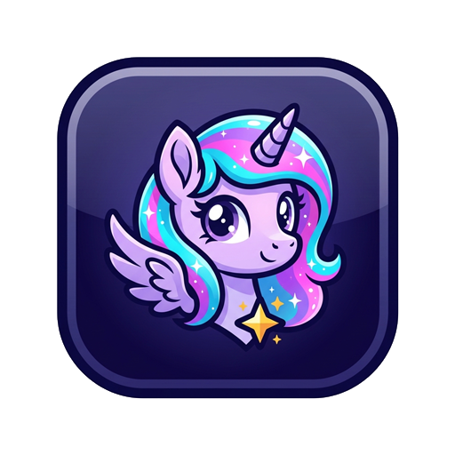
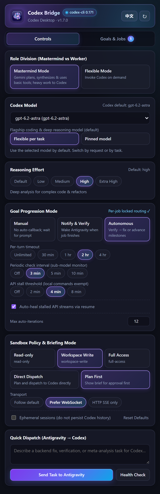
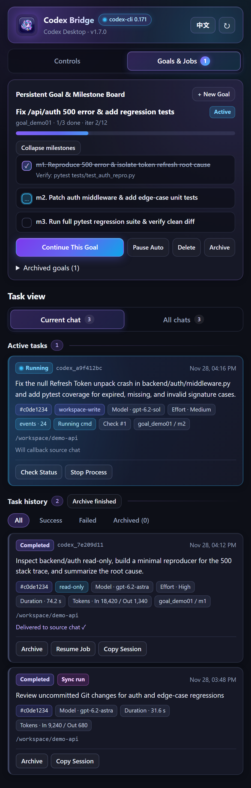
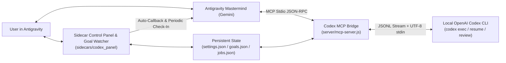

<div align="center">



# Codex Bridge

**Just describe what you want in plain language — let Antigravity (Gemini) turn it into precise specs, dispatch your local OpenAI Codex (GPT) worker, and supervise every step until verified.**

[](./plugin.json)
[](https://nodejs.org/)
[](#architecture)
[](https://modelcontextprotocol.io/)
[](./LICENSE)

**English** · [简体中文](./README.zh-CN.md)

</div>

---

## Why Codex Bridge?

**OpenAI Codex (GPT) is an extraordinary coding & execution engine — but it depends heavily on crisp, detailed prompts to shine.**

For beginners — or anyone who doesn't want to spend 20 minutes writing an engineering spec — a casual instruction sent straight to Codex can easily drift, miss edge cases, or require manual babysitting. Meanwhile, **Google Antigravity (Gemini)** excels at understanding plain human intent, structuring complex ideas into clear requirements, and reviewing outcomes.

**Codex Bridge combines the best of both worlds into one closed loop:** talk to Antigravity naturally, let it translate your goal into precise, unambiguous instructions for your local Codex CLI, and let Antigravity monitor progress, verify diffs/tests, and steer Codex back on track until the job is truly done.

| Pain Point When Using Codex Alone | With Codex Bridge |
| :--- | :--- |
| **Prompt-sensitive & intimidating for beginners**: Vague requests cause Codex to drift; hand-writing detailed engineering specs takes effort | **Gemini as Translator & Tech Lead**: Speak in plain language — Antigravity gathers context, breaks down milestones, and writes crystal-clear specs Codex thrives on |
| **No automated supervision**: When Codex finishes, you still have to inspect diffs, run tests, and paste errors back manually | **End-to-End Supervised Loop**: Codex runs in the background and automatically wakes Antigravity on completion to verify results — or dispatch a targeted fix |
| **Long tasks stall silently on flaky networks**: One network hiccup can leave a terminal session stuck or looping for 20 minutes unnoticed | **Auto-Heal Watchdog + Periodic Inspection**: Distinguishes active local commands from hung API streams, auto-resumes stalled runs, and uses a lightweight sub-model for periodic health checks |
| **Opaque CLI workflow & lost progress**: Switching models, timeouts, or permissions requires CLI flags; chat compaction wipes multi-step context | **Native Side-Pane Control Panel & Goal Board**: Click to switch models, reasoning effort, timeouts, sandbox & transport; goals and milestones persist on disk |

---

## How It Works in 4 Steps

1. **You state your goal naturally** — e.g. *"Find why `/api/login` returns 500 and add regression tests"* or *"Clean this dataset, run sensitivity analysis, and export the figures."*
2. **Antigravity drafts an executable spec & dispatches Codex** — inspects key files, defines verifiable milestones, and launches your local Codex CLI in the background.
3. **Codex builds & tests while Codex Bridge guards the run** — Codex edits files and runs shell/test commands; the L1 watchdog protects active commands while auto-healing hung API streams, and L2 periodic checks inspect progress via a lightweight sub-model.
4. **Automatic wakeup, verification & progression** — as soon as Codex finishes, Antigravity wakes up automatically, reviews the diff/tests, reports clearly to you, or advances to the next milestone.

---

## Side-Pane Control Panel Preview

Native dark UI embedded directly inside Antigravity's **Plugins** side pane, with live **English / 中文** switching:

<table>
  <tr>
    <th align="center">Controls — Model, Routing, Watchdog &amp; Permissions</th>
    <th align="center">Goals &amp; Jobs — Milestone Board, Live Phase &amp; History</th>
  </tr>
  <tr>
    <td align="center" valign="top">
      
    </td>
    <td align="center" valign="top">
      
    </td>
  </tr>
</table>

---

## Key Highlights

- **Mastermind + Worker Synergy (`orchestrator` / `flexible`)**
  Antigravity focuses on understanding your intent, writing tight specifications, orchestrating plugins, and verifying results — while delegating heavy coding, backend debugging, and data/analysis pipelines to Codex.
- **Flexible Model Routing & Per-Task Control**
  Reads your local `~/.codex/models_cache.json` automatically. Use **Flexible per task** to say *"run this with `gpt-6.2-sol`"* on the fly, or switch to **Pinned model** to lock a single worker model.
- **Three-Tier Monitoring & Stall Auto-Heal (`v1.7.0`)**
  - **L1 Phase-Aware Watchdog**: Protects running local commands (`running_cmd`) from false kills, while automatically recovering stalled `waiting_api` / `reconnecting` streams via idempotent breakpoint resume.
  - **L2 Periodic Sub-Model Inspection**: Sends configurable periodic check-ins (`Off / 3 / 5 / 10 min`) to the original conversation so Antigravity can delegate fast, read-only health checks to a lightweight `flash_lite` subagent without cluttering the main context.
  - **Transport & Clean Exit Controls**: Switch between `Follow default`, `Prefer WebSocket`, and `HTTP SSE only`, disable desktop notify hooks on headless runs, and cleanly exit lingering post-completion streams after 5 seconds.
- **Native Bilingual Side-Pane Control Panel (EN / 中文)**
  Lives right inside Antigravity's **Plugins** menu with two clean tabs (**Controls** & **Goals & Jobs**):
  - One-click controls for **Model**, **Reasoning effort** (`low` → `ultra`), **Progression mode** (`manual` / `notify` / `autonomous`), **Per-turn timeout** (`Unlimited` → `4 hr`), **Sandbox policy**, **Briefing workflow** (`direct` / `plan_first`), **Transport**, **Auto-heal**, and **Periodic check interval**.
  - Persistent **Goal & Milestone board** surviving chat compaction and restarts, with **one-click archiving** for completed goals/records and ergonomic scrollable prompt expansion.
- **Zero Dependencies & Automatic Codex Discovery**
  Pure Node.js ESM (`>= 18`) — no `npm install`, no build step. Automatically finds your installed Codex CLI (including Codex Desktop's bundled `codex.exe` on Windows across auto-updates) and reuses your existing login.

---

> [!IMPORTANT]
> **Network Stability Note**: **Google Antigravity itself** — as well as long-running OpenAI Codex CLI streaming sessions — has **high requirements for network stability**. On unstable networks or flaky proxy nodes, long connections can silently drop or stall (`idle timeout waiting for SSE` / `tls handshake eof`). For the smoothest experience:
> - Use a stable, low-latency network or proxy node;
> - Switch **Transport** in the side-pane panel to **Prefer WebSocket** if HTTP SSE stalls;
> - Keep the built-in **L1 Auto-Heal Watchdog** and **Periodic Sub-Model Inspection** enabled so transient stalls recover automatically.

---

## Quick Start

### Prerequisites

- **Google Antigravity** (Desktop or CLI)
- **Node.js `>= 18`**
- **OpenAI Codex** (Codex Desktop app or `codex` CLI installed and signed in)

### Install (30 seconds)

**Windows (PowerShell):**
```powershell
git clone https://github.com/yeyuhants-prog/codex-bridge.git "$env:USERPROFILE\.gemini\config\plugins\codex-bridge"
```

**macOS / Linux:**
```bash
git clone https://github.com/yeyuhants-prog/codex-bridge.git ~/.gemini/config/plugins/codex-bridge
```

### Enable & Open the Panel

1. Open **Skills & Customizations** in Antigravity's left sidebar and toggle **Codex Bridge** **ON**.
2. Open the control panel from the right-hand **Plugins** menu → **Codex Bridge**.
3. Pick your preferred **model**, **reasoning effort**, **progression mode** (`notify` or `autonomous`), and **sandbox** — then just start talking to Antigravity in plain language.

### Example Prompts

- **Plain-language bug fix (no spec needed):**
  > *"Users are seeing a 500 error in `backend/auth`. Figure out the root cause, write a clear plan for Codex to fix it, and keep verifying until `pytest` is completely green."*
- **Step-by-step data / research pipeline:**
  > *"Help me clean this dataset, check heterogeneity (I² / Q-test), run sensitivity analysis, and export forest plots. Break it into milestones, let Codex write and run the scripts, and verify every output table for me."*
- **On-the-fly model routing:**
  > *"Use `gpt-6.2-sol` with `medium` reasoning effort to build a small calculator web app and unit tests, and monitor progress until it passes."*
- **Git code review:**
  > *"Have Codex review my uncommitted Git changes in this repo and highlight real bugs or edge cases."*

---

## Architecture



## MCP Tools (9)

| Tool | Description |
| --- | --- |
| `codex_goal` | Create, inspect, update milestones, pause/resume, archive/unarchive, or delete persistent multi-step Goals synced with the Sidecar goal board. |
| `codex_run` | Run a task synchronously via `codex exec` using active panel settings (or per-call overrides). Supports `goal_id`, `milestone_id`, `force_model`, and `timeout_seconds` (`0` = unlimited). |
| `codex_resume` | Continue by `resume_job_id` or an exact session UUID. Unknown sessions default to read-only. |
| `codex_review` | Run Codex's built-in non-interactive Git code review (`uncommitted`, `base` branch, or `commit` SHA). |
| `codex_start` | Launch a persistent background Codex worker and return `job_id` immediately; supports L1 auto-heal watchdog, periodic check-ins, and completion auto-callbacks. |
| `codex_status` | Inspect live phase (`waiting_api` / `running_cmd` / `reconnecting`), progress events, auto-heal & periodic check counts, `Session ID`, or final output of a background job. |
| `codex_cancel` | Terminate a running background Codex job along with its child process tree. |
| `codex_config` | Read or update shared panel settings (`model`, `model_routing`, `reasoning_effort`, `sandbox`, `workflow_mode`, `progression_mode`, `task_timeout_seconds`, `transport`, `auto_heal_enabled`, `stall_threshold_seconds`, `max_auto_heals`, `monitor_interval_seconds`, `max_auto_iterations`) and list local Codex models. |
| `codex_info` | Health check showing resolved Codex binary & version, active panel settings, watchdog/monitor configuration, active goal progress, and tracked jobs. |

<details>
<summary><strong>Advanced Reliability & Security Guarantees (click to expand)</strong></summary>

- **Per-Job Locked Callbacks & Explicit Retry**: Callback targets (`conversationId` / `projectId`) are locked from trusted Antigravity host context at job dispatch time (`GET /api/state` is strictly read-only, preventing cross-conversation leaks). Conflicting request and host conversation IDs are rejected; failed deliveries remain visibly marked `failed` with one-click retry strictly to the original source conversation.
- **Restart-Resilient Jobs & Cross-Process Session Locks**: Background jobs persist to `jobs.json` with atomic per-session file locks (`locks/`). If the MCP server restarts while a Codex process is still alive, the job transitions to `running_detached` (blocking duplicate spawns until it finishes or is explicitly stopped).
- **Safe Structured Resumes**: Resuming via `resume_job_id` or panel **Resume Job** retains the parent working directory, `session_id`, `goal_id`, `milestone_id`, callback destination, and execution policy (placing `-C` / `-s` before `resume`). Milestone overrides must belong to the same goal. Cross-conversation panel resumes return HTTP `409` until the caller selects `keepOriginalCallback: true` or `transferCallback: true`; MCP transfers require `transfer_callback: true` (recorded in `transferredFrom`). Expanding writable directories or sandbox permissions requires boolean `allow_sandbox_escalation: true`.

</details>

## Environment Variables

| Variable | Default | Purpose |
| --- | --- | --- |
| `CODEX_BIN` | Auto-discovered | Explicit path to the `codex` / `codex.exe` binary. |
| `CODEX_HOME` | `~/.codex` | Directory containing Codex's `config.toml` and `models_cache.json`. |
| `CODEX_BRIDGE_DATA_DIR` | `~/.gemini/antigravity/plugin_data/codex-bridge` | Directory storing `settings.json`, `goals.json`, `jobs.json`, and `history.json`. |

## Testing

```bash
# Zero-token MCP protocol, settings & persistent goal board smoke test
npm test

# Full automated unit, acceptance, and regression suites (v1.4 ~ v1.7)
node --test test/panel-ui.test.mjs
node test/acceptance-v14.mjs
node test/regression-v15.mjs
node test/regression-v16.mjs
node --test test/regression-v17.mjs

# End-to-end live check against your local Codex CLI (read-only, ephemeral)
npm run test:live
```

## Project Structure

```text
codex-bridge/
├── plugin.json                 # Antigravity plugin manifest
├── mcp_config.json             # Portable MCP server definition
├── assets/
│   └── logo.png                # Plugin icon (512×512 transparent PNG)
├── server/
│   ├── mcp-server.js           # Zero-dependency MCP Stdio JSON-RPC server
│   ├── codex-runner.js         # Codex CLI auto-discovery, spawn & JSONL parser
│   ├── goal-store.js           # Persistent Goal & Milestone state machine
│   ├── job-manager.js          # Persistent async worker & process-tree manager
│   └── settings-store.js       # Shared preferences, history & model catalog reader
├── sidecars/
│   └── codex_panel/            # Native Antigravity side-pane UI & callback watcher
│       ├── sidecar.json
│       ├── main.mjs
│       ├── index.html
│       ├── app.js
│       └── styles.css
├── skills/
│   └── codex-worker/SKILL.md   # Orchestration skill for Antigravity
├── rules/
│   └── AGENTS.md               # Active rules while plugin is enabled
└── test/                       # Smoke, unit, UI & regression test suites
```

## License

Released under the [MIT License](./LICENSE).
