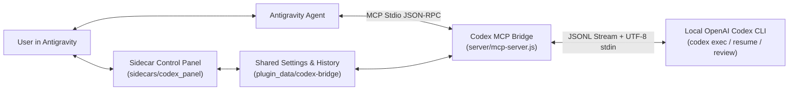

<div align="center">


# Codex Bridge

**An Antigravity plugin with an interactive control panel and zero-dependency MCP bridge to orchestrate your local OpenAI Codex CLI.**

[](./plugin.json)
[](https://nodejs.org/)
[](#architecture)
[](https://modelcontextprotocol.io/)
[](./LICENSE)

**English** · [简体中文](./README.zh-CN.md)

</div>

---

## Why Codex Bridge?

**Codex Bridge** turns your local **OpenAI Codex CLI** into a first-class coding worker inside **Google Antigravity**.

- Let **Antigravity** analyze requirements, inspect your codebase, draft clear specifications, and review final diffs.
- Let **Codex** execute edits, run builds/tests, perform multi-turn fixes, and handle parallel background tasks — all through native **MCP tools** and a **live side-pane UI** without leaving your conversation.

## Features

- **Native Interactive Sidecar Panel** — Appears right inside Antigravity's **Plugins** side-pane menu for one-click control over:
  - **Model selection** (auto-populated from your local `~/.codex/models_cache.json`)
  - **Reasoning effort** (dynamically adapts to each model's supported levels: `low`, `medium`, `high`, `xhigh`, `max`, `ultra`)
  - **Sandbox policy** (`read-only`, `workspace-write`, `danger-full-access`)
  - **Workflow mode** (*Direct execution* vs. *Plan-first confirmation*)
  - **Live run history** with duration, token usage, status badges, and one-click `Session ID` copy
- **One-Click Plugin Toggle** — Enable or disable the MCP server, UI panel, `codex-worker` skill, and active rules together as a single unit from Antigravity's **Customizations** page.
- **Automatic Codex Discovery** — Automatically locates the newest `codex.exe` bundled with Codex Desktop on Windows (`%LOCALAPPDATA%\OpenAI\Codex\bin\*\codex.exe`), falls back to `codex` on `PATH`, or respects a custom `CODEX_BIN` environment variable.
- **Sync & Async Parallel Execution** — Use synchronous calls with live MCP progress streaming for quick tasks, or spawn multiple background Codex workers in parallel with long-polling and clean process-tree cancellation.
- **Multi-Turn Session Continuity** — Every run captures its Codex `Session ID`, allowing follow-up iterations via `codex_resume` with full context preserved.
- **Zero External Dependencies** — Pure Node.js ESM (`>= 18`). No `npm install`, no build step, instant startup, UTF-8 `stdin` prompting (immune to Windows shell quoting and length limits).

## Architecture



## Quick Start

### Prerequisites

- **Google Antigravity** (Desktop or CLI)
- **Node.js `>= 18`**
- **OpenAI Codex** (Codex Desktop app or `codex` CLI installed and signed in)

### Install

Clone this repository directly into Antigravity's global plugins directory:

**macOS / Linux:**
```bash
git clone https://github.com/yeyuhants-prog/codex-bridge.git ~/.gemini/config/plugins/codex-bridge
```

**Windows (PowerShell):**
```powershell
git clone https://github.com/yeyuhants-prog/codex-bridge.git "$env:USERPROFILE\.gemini\config\plugins\codex-bridge"
```

### Enable & Open the Panel

1. Open **Skills & Customizations** (自定义扩展) in Antigravity's left sidebar and confirm **Codex Bridge** is toggled **ON**.
2. Open the interactive control panel from the right-hand **Plugins** (`插件`) menu → **Codex Bridge**.
3. Pick your preferred **Codex model**, **reasoning effort**, **sandbox**, and **workflow mode** — changes save immediately and apply automatically to every subsequent Codex call.

## MCP Tools

| Tool | Description |
| --- | --- |
| `codex_run` | Run a task synchronously via `codex exec` using your active panel settings (or per-call overrides). Returns response text, `Session ID`, modified files, executed commands, and token usage. |
| `codex_resume` | Continue a previous Codex session by `session_id` (or `"last"`) with follow-up instructions. |
| `codex_review` | Run Codex's built-in non-interactive Git code review (`uncommitted`, `base` branch, or `commit` SHA). |
| `codex_start` | Start a Codex task asynchronously in the background and immediately return a `job_id` (ideal for long tasks or parallel workers). |
| `codex_status` | Inspect progress events or final output of a background job (supports `wait_seconds` long-polling), or list all tracked jobs. |
| `codex_cancel` | Terminate a running background Codex job along with its child process tree. |
| `codex_config` | Read or update shared preferences (`model`, `reasoning_effort`, `sandbox`, `workflow_mode`) and list available local Codex models. |
| `codex_info` | Health check displaying resolved Codex binary path, CLI version, active panel preferences, and background job summary. |

## Example Prompts

Once enabled, simply talk to Antigravity naturally:

- **Health & config check:**
  > *"Check Codex Bridge status and list my available local Codex models."*
- **Architect + worker flow:**
  > *"Inspect `src/auth/` and write a detailed specification, then dispatch Codex to implement refresh-token rotation and run the unit tests."*
- **Code review:**
  > *"Have Codex review my uncommitted Git changes in this repository and summarize any bugs or edge cases."*
- **Per-call model override:**
  > *"Use `gpt-6.2-astra` with `xhigh` reasoning effort and have Codex refactor the parser module."*
- **Parallel background workers:**
  > *"Launch two background Codex tasks in parallel: one to add API integration tests and another to update the OpenAPI docs."*

## Environment Variables

All environment variables are optional:

| Variable | Default | Purpose |
| --- | --- | --- |
| `CODEX_BIN` | Auto-discovered | Explicit path to the `codex` / `codex.exe` binary. |
| `CODEX_HOME` | `~/.codex` | Directory containing Codex's `config.toml` and `models_cache.json`. |
| `CODEX_BRIDGE_DATA_DIR` | `~/.gemini/antigravity/plugin_data/codex-bridge` | Directory storing shared `settings.json` and `history.json`. |

## Testing

Run the zero-token MCP protocol & configuration smoke test:

```bash
npm test
```

Run an end-to-end live check against your local Codex CLI (read-only, ephemeral):

```bash
npm run test:live
```

## Project Structure

```text
codex-bridge/
├── plugin.json                 # Antigravity plugin manifest
├── mcp_config.json             # Portable MCP server definition
├── assets/
│   └── logo.png                # Plugin icon (512×512 transparent PNG)
├── server/
│   ├── mcp-server.js           # Zero-dependency MCP Stdio JSON-RPC server
│   ├── codex-runner.js         # Codex CLI auto-discovery, spawn & JSONL parser
│   ├── job-manager.js          # Async background worker & process-tree manager
│   └── settings-store.js       # Shared preferences, history & model catalog reader
├── sidecars/
│   └── codex_panel/            # Native Antigravity interactive side-pane UI
│       ├── sidecar.json
│       ├── main.mjs
│       ├── index.html
│       ├── app.js
│       └── styles.css
├── skills/
│   └── codex-worker/SKILL.md   # Orchestration skill for Antigravity
├── rules/
│   └── AGENTS.md               # Active rules while plugin is enabled
└── test/
    └── smoke-test.mjs          # End-to-end MCP smoke test
```

## License

Released under the [MIT License](./LICENSE).
