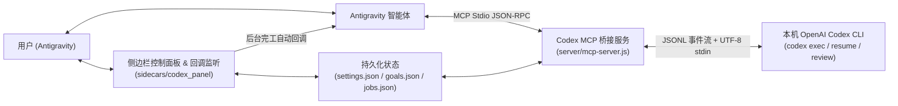

<div align="center">


# Codex Bridge

**带原生交互式控制面板、持久化目标板、完工自动回调闭环与零依赖 MCP 桥接服务的 Antigravity 插件，直接指挥你本机的 OpenAI Codex CLI 持续排查、验证与推进任务。**

[](./plugin.json)
[](https://nodejs.org/)
[](#架构一览)
[](https://modelcontextprotocol.io/)
[](./LICENSE)

[English](./README.md) · **简体中文**

</div>

---

## 核心特性

- **主脑 + 打工人分工模式（`orchestrator` / `flexible`）**：默认开启 **主脑派活模式**——反重力发挥文本规划、写清晰可执行任务单、整合阶段汇报的长板（同时保留轻量工具与其他基础插件的正常使用），把重度编码、后端排查和数据分析脚本执行全部派给 Codex，并通过 `codex_start(conversation_id=...)` 形成自动汇报闭环。
- **原生侧边栏交互面板（中 / EN 一键切换 + 控制台/目标双页签）**：直接出现在 Antigravity 右侧「插件」菜单中，右上角支持一键切换中英文界面与回调文案，并可视化实时调整：
  - **Codex 干活模型**（自动读取本机 `~/.codex/models_cache.json` 中的全部可用模型）
  - **思考深度（Reasoning Effort）**（随模型动态适配 `low / medium / high / xhigh / max / ultra`）
  - **目标推进模式（Progression Mode）**（随时切换）：
    - `手动推进 (manual)` — Codex 干完不自动发消息，等你指示下一步。
    - `完工自动验收 (notify)` — 后台 Codex 任务完成后自动唤醒反重力验收并汇报结论。
    - `持续自动推进 (autonomous)` — 后台任务完工后自动触发反重力验收、更新里程碑、未通过则 `codex_resume` 返工，通过则自动推进下一里程碑（带最大自动轮次上限与一键「暂停自动推进」保护）。
  - **执行权限（Sandbox）**与**派活方式**（`直接派活` / `先出任务单确认`）
- **持久化目标与里程碑状态机（`goals.json`）**：总目标、子里程碑、验证命令、卡点与关联 `Session ID` 全部落盘保存，长对话压缩或重启不丢进度。
- **按任务锁定回调目标与失败重试**：派活时从 Antigravity 可信宿主上下文锁定每个任务的 `conversationId` / `projectId`；显式对话与宿主上下文冲突时拒绝派发；投递失败不会误标「已回调」，支持在面板一键定向重试回原对话。
- **跨进程会话互斥锁与结构化续跑**：后台任务落盘至 `jobs.json` 并按 `Session ID` 加原子文件锁（`locks/`）；服务重启时若原 `codex.exe` 进程仍存活则标为 `running_detached`（等待结束或显式停止前禁止重复续跑）。通过 `resume_job_id` 或面板「结构化续跑」会继承原 `session_id`、`cwd`、`sandbox`、`goal_id` 与 `milestone_id`，并将 `-C` / `-s` 置于 `resume` 之前，默认沿用原权限且拦截未确认的提权。

结构化续跑沿用父任务的目录、目标、执行权限和回调目标。同一目标内可以选择已有里程碑。跨对话面板请求先返回 HTTP 409，由调用方选择 `keepOriginalCallback: true` 保留来源或 `transferCallback: true` 转交。MCP 转交使用 `transfer_callback: true`，子任务的 `transferredFrom` 记录前一对话。扩大沙箱或新增可写目录需要布尔值 `allow_sandbox_escalation: true`。
- **自动发现本机 Codex**：Windows 下自动定位 Codex Desktop 最新版 `codex.exe`（自动更新换哈希目录无缝兼容），同时支持 `PATH` 和 `CODEX_BIN`。
- **零外部依赖**：纯 Node.js ESM（`>= 18`），免 `npm install`，通过 UTF-8 `stdin` 传提示词。

## 架构一览



## 快速安装

**Windows (PowerShell)：**
```powershell
git clone https://github.com/yeyuhants-prog/codex-bridge.git "$env:USERPROFILE\.gemini\config\plugins\codex-bridge"
```

**macOS / Linux：**
```bash
git clone https://github.com/yeyuhants-prog/codex-bridge.git ~/.gemini/config/plugins/codex-bridge
```

## 提供的 9 个 MCP 工具

| 工具 | 用途 |
| --- | --- |
| `codex_goal` | 创建、查询、更新里程碑、暂停/恢复或删除持久化目标（与侧边栏目标板实时同步） |
| `codex_run` | 同步执行 Codex 任务（自动应用面板选中的模型、思考深度与沙箱权限，可关联 `goal_id` / `milestone_id`） |
| `codex_resume` | 按父任务 `resume_job_id` 或完整会话 UUID 续跑。未知会话默认只读 |
| `codex_review` | 调用 `codex exec review` 对 Git 仓库做代码审查 |
| `codex_start` | 后台异步启动持久化 Codex 任务并立即返回 `job_id`（完工自动触发回调） |
| `codex_status` | 查看后台任务实时进度、断点中断状态或最终结果（支持 `wait_seconds` 长轮询） |
| `codex_cancel` | 终止正在运行的后台 Codex 任务并清理子进程树 |
| `codex_config` | 读取/更新与侧边栏共享的默认配置（含推进模式与自动轮次上限），并列出本机可用模型 |
| `codex_info` | 健康检查，查看 `codex.exe` 路径、版本、面板配置、绑定对话与当前目标进度 |

## 自测

```bash
npm test
# 如需真机执行一次只读临时 codex_run：
npm run test:live
```

## 开源协议

基于 [MIT License](./LICENSE) 开源。
