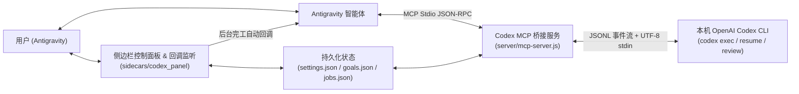

<div align="center">


# Codex Bridge

**带原生交互式控制面板、持久化目标板、完工自动回调闭环与零依赖 MCP 桥接服务的 Antigravity 插件，直接指挥你本机的 OpenAI Codex CLI 持续排查、验证与推进任务。**

[](./plugin.json)
[](https://nodejs.org/)
[](#架构一览)
[](https://modelcontextprotocol.io/)
[](./LICENSE)

[English](./README.md) · **简体中文**

</div>

---

> [!IMPORTANT]
> **网络环境提示**：**Antigravity 本身**以及长时流式运行的 **OpenAI Codex CLI** 对网络稳定性要求较高——在弱网或代理节点抖动的情况下，长连接容易出现静默断流、重连卡顿（如 `idle timeout waiting for SSE`、`tls handshake eof`）。建议：
> - 尽量选用稳定、低延迟的网络/代理节点；
> - 如遇纯 HTTP SSE 偶发挂起，可在侧边栏将「连接方式」切换为 **`WebSocket 优先`**；
> - 保持默认的 **L1 断流自动自愈看门狗** 与 **定时检验（轻量子模型巡检）** 开启，遇到偶发网络波动时可自动断点续接与及时发现异常。

## 核心特性

- **主脑 + 打工人分工模式（`orchestrator` / `flexible`）**：默认开启 **主脑派活模式**——反重力发挥文本规划、写清晰可执行任务单、整合阶段汇报的长板（同时保留轻量工具与其他基础插件的正常使用），把重度编码、后端排查和数据分析脚本执行全部派给 Codex，并通过 `codex_start(conversation_id=...)` 形成自动汇报闭环。
- **灵活模型路由 + 指定干活模型（`flexible` / `pinned`）**：可在侧边栏选择默认干活模型（自动读取 `~/.codex/models_cache.json`），并随时切换：
  - **`按指令灵活切换 (flexible)`**：默认使用选定模型，同时支持在对话中点名模型（如“用 `gpt-6.2-sol` 跑”）或按任务复杂度动态切换；
  - **`锁定指定模型 (pinned)`**：严格锁定上方指定模型，除非显式传 `force_model: true` 否则拒绝覆盖。
- **三层监控与断流自愈体系（v1.7.0）**：
  - **L1 阶段感知看门狗 & 自动断点自愈**：实时区分 `running_cmd`（本地执行 Shell/Gradle/Python/R 命令，**看门狗自动豁免不误杀**）与 `waiting_api` / `reconnecting`；当等待 API 静默超过阈值（`关闭 / 2 / 4 / 8 分钟`）或持续重连卡死时，自动终止假死流并通过 `resume_job_id` 发起幂等断点续跑（最多 `maxAutoHeals` 次，且不消耗目标轮次预算），超出熔断次数再唤醒告警。
  - **L2 定时检验 + 轻量子模型巡检**：支持配置定时巡检间隔（`关闭 / 3 / 5 / 10 分钟`），按原锁定对话推送 `[Codex Bridge 定时检验 #N]`，引导主脑委托只读轻量子模型（`flash_lite`）快速体检并回传 ≤5 行结构化结论，避免污染主脑上下文。
  - **传输通道控制 & 完工 5 秒拖尾清理**：控制台支持切换 **`跟随默认` / `WebSocket 优先` / `仅 HTTP SSE`**，无头 CLI 默认附带 `notify=[]` 屏蔽桌面钩子，并在 `turn.completed` 后自动清理残留退出拖尾且不产生虚假告警。
- **每轮任务时长上限（不限时 → 4 小时）**：控制台内置 **`不限时 (0)` / `30 分钟` / `1 小时` / `2 小时` / `4 小时`** 5 档选择，默认 2 小时，续跑自动继承。
- **原生侧边栏交互面板（中 / EN 一键切换 + 控制台/目标双页签）**：直接出现在 Antigravity 右侧「插件」菜单中，支持实时切换模型、思考深度（`low` → `ultra`）、目标推进模式（`手动推进` / `完工自动验收` / `持续自动推进`）、执行权限（`只读` / `工作区可写` / `完全权限`）与派活方式（`直接派活` / `先出任务单确认`）。
- **历史目标与执行记录归档 + 展开收起优化**：目标板与历史筛选默认仅展示未归档项，支持一键「归档已完成」与单条归档/恢复（收入默认折叠的「已归档目标」抽屉与「已归档」筛选页签，运行中任务受保护不可归档）；长提示词展开改为有界可滚动玻璃框（`max-height: 260px`），确保「收起全文」永远留在视野内，并支持目标里程碑折叠与一键「全部收起」。
- **持久化目标与里程碑状态机（`goals.json`）**：总目标、子里程碑、验证命令、卡点与关联 `Session ID` 全部落盘保存，长对话压缩或重启不丢进度。
- **按任务锁定回调目标与失败重试**：派活时从 Antigravity 可信宿主上下文锁定每个任务的 `conversationId` / `projectId`；显式对话与宿主上下文冲突时拒绝派发；投递失败不会误标「已回调」，支持在面板一键定向重试回原对话。
- **跨进程会话互斥锁与结构化续跑**：后台任务落盘至 `jobs.json` 并按 `Session ID` 加原子文件锁（`locks/`）；服务重启时若原 `codex.exe` 进程仍存活则标为 `running_detached`（等待结束或显式停止前禁止重复续跑）。通过 `resume_job_id` 或面板「结构化续跑」会继承原 `session_id`、`cwd`、`sandbox`、`goal_id` 与 `milestone_id`，并将 `-C` / `-s` 置于 `resume` 之前，默认沿用原权限且拦截未确认的提权。

结构化续跑沿用父任务的目录、目标、执行权限和回调目标。同一目标内可以选择已有里程碑。跨对话面板请求先返回 HTTP 409，由调用方选择 `keepOriginalCallback: true` 保留来源或 `transferCallback: true` 转交。MCP 转交使用 `transfer_callback: true`，子任务的 `transferredFrom` 记录前一对话。扩大沙箱或新增可写目录需要布尔值 `allow_sandbox_escalation: true`。
- **自动发现本机 Codex**：Windows 下自动定位 Codex Desktop 最新版 `codex.exe`（自动更新换哈希目录无缝兼容），同时支持 `PATH` 和 `CODEX_BIN`。
- **零外部依赖**：纯 Node.js ESM（`>= 18`），免 `npm install`，通过 UTF-8 `stdin` 传提示词。

## 架构一览



## 快速安装

**Windows (PowerShell)：**
```powershell
git clone https://github.com/yeyuhants-prog/codex-bridge.git "$env:USERPROFILE\.gemini\config\plugins\codex-bridge"
```

**macOS / Linux：**
```bash
git clone https://github.com/yeyuhants-prog/codex-bridge.git ~/.gemini/config/plugins/codex-bridge
```

## 提供的 9 个 MCP 工具

| 工具 | 用途 |
| --- | --- |
| `codex_goal` | 创建、查询、更新里程碑、暂停/恢复、归档/还原或删除持久化目标（与侧边栏目标板实时同步） |
| `codex_run` | 同步执行 Codex 任务（自动应用面板选中的模型、思考深度、时长上限与沙箱权限，支持 `force_model` 与 `timeout_seconds=0` 不限时） |
| `codex_resume` | 按父任务 `resume_job_id` 或完整会话 UUID 续跑。未知会话默认只读 |
| `codex_review` | 调用 `codex exec review` 对 Git 仓库做代码审查 |
| `codex_start` | 后台异步启动持久化 Codex 任务并立即返回 `job_id`（支持 L1 断流自动自愈、定时巡检与完工自动回调） |
| `codex_status` | 查看后台任务实时阶段（`waiting_api` / `running_cmd` / `reconnecting`）、自愈/巡检次数、进展事件或最终结果 |
| `codex_cancel` | 终止正在运行的后台 Codex 任务并清理子进程树 |
| `codex_config` | 读取/更新与侧边栏共享的默认配置（含模型路由、单轮时长上限、传输通道、断流看门狗与定时检验间隔），并列出本机可用模型 |
| `codex_info` | 健康检查，查看 `codex.exe` 路径、版本、面板配置、看门狗/定时巡检状态与当前目标进度 |

## 自测

```bash
npm test
node --test test/panel-ui.test.mjs
node test/acceptance-v14.mjs
node test/regression-v15.mjs
node test/regression-v16.mjs
node --test test/regression-v17.mjs
# 如需真机执行一次只读临时 codex_run：
npm run test:live
```

## 开源协议

基于 [MIT License](./LICENSE) 开源。
