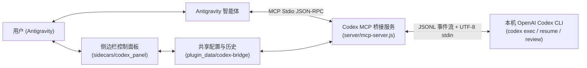

<div align="center">


# Codex Bridge

**带原生交互式控制面板与零依赖 MCP 桥接服务的 Antigravity 插件，直接指挥你本机的 OpenAI Codex CLI 干活。**

[](./plugin.json)
[](https://nodejs.org/)
[](#架构一览)
[](https://modelcontextprotocol.io/)
[](./LICENSE)

[English](./README.md) · **简体中文**

</div>

---

## 核心特性

- **原生侧边栏交互面板（Sidecar UI）**：直接出现在 Antigravity 右侧「插件」菜单中，可视化实时调整：
  - **Codex 干活模型**（自动读取本机 `~/.codex/models_cache.json` 中的全部可用模型）
  - **思考深度（Reasoning Effort）**（随模型动态适配 `low / medium / high / xhigh / max / ultra`）
  - **执行权限（Sandbox）**（`read-only` / `workspace-write` / `danger-full-access`）
  - **协作方式**（`直接派活执行` vs. `先出详细任务单确认后再执行`）
  - **快捷发活 & 最近执行记录**（查看耗时、Token 统计，一键复制 `Session ID`）
- **插件一键开关**：在 Antigravity 左侧 **自定义扩展** 中随时开关，开启后 UI 面板、MCP 工具、协作技能与激活规则整体生效，关闭后完整停用。
- **自动发现本机 Codex**：Windows 下自动定位 Codex Desktop 内置最新版 `codex.exe`（升级换哈希目录不失效），同时支持 `PATH` 和 `CODEX_BIN` 环境变量。
- **同步 + 异步并行**：短任务实时推送进度并同步返回；大重构或多路任务支持 `codex_start` 后台并行派发与进程树级取消。
- **零外部依赖**：纯 Node.js ESM（`>= 18`），免 `npm install`，通过 UTF-8 `stdin` 传提示词，彻底避开 Windows 命令行转义与长度限制。

## 架构一览



## 快速安装

将本仓库克隆到 Antigravity 的全局插件目录：

**Windows (PowerShell)：**
```powershell
git clone https://github.com/yeyuhants-prog/codex-bridge.git "$env:USERPROFILE\.gemini\config\plugins\codex-bridge"
```

**macOS / Linux：**
```bash
git clone https://github.com/yeyuhants-prog/codex-bridge.git ~/.gemini/config/plugins/codex-bridge
```

安装后：
1. 在左侧 **自定义扩展** 中确认 **Codex Bridge** 已开启；
2. 在右侧 **插件** 菜单中打开 **Codex Bridge** 面板，点选想用的模型与思考深度即可实时生效。

## 提供的 8 个 MCP 工具

| 工具 | 用途 |
| --- | --- |
| `codex_run` | 同步执行 Codex 任务（自动应用面板选中的模型、思考深度与沙箱权限） |
| `codex_resume` | 按 `session_id`（或 `"last"`）延续上次 Codex 会话上下文 |
| `codex_review` | 调用 `codex exec review` 对 Git 仓库做代码审查 |
| `codex_start` | 后台异步启动 Codex 任务并立即返回 `job_id`（适合长任务或并行多开） |
| `codex_status` | 查看后台任务实时进度或最终结果（支持 `wait_seconds` 长轮询） |
| `codex_cancel` | 终止正在运行的后台 Codex 任务并清理子进程树 |
| `codex_config` | 读取/更新与侧边栏 UI 共享的默认配置，并列出本机可用模型 |
| `codex_info` | 健康检查，查看 `codex.exe` 路径、版本、当前生效配置与任务状态 |

## 自测

```bash
npm test
# 如需真机执行一次只读临时 codex_run：
npm run test:live
```

## 开源协议

基于 [MIT License](./LICENSE) 开源。
