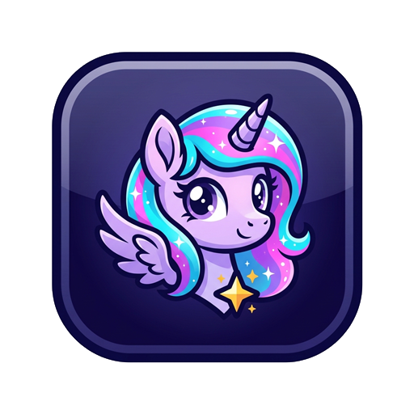
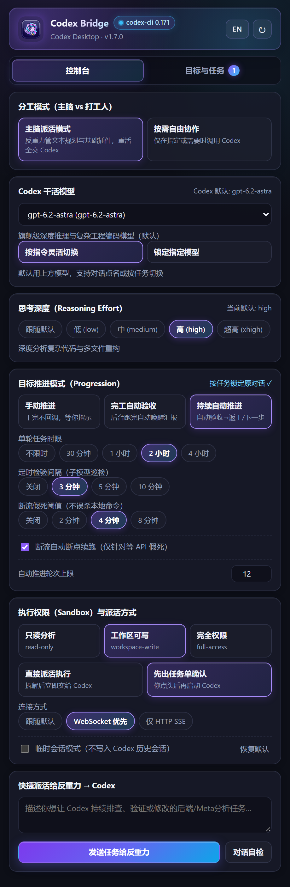
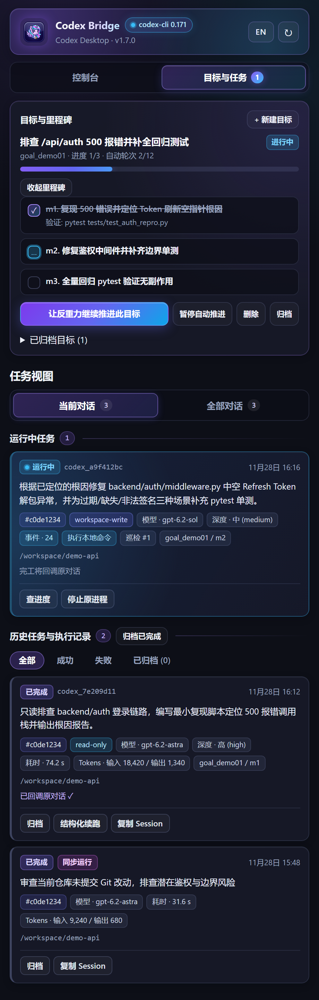
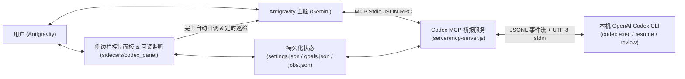

<div align="center">



# Codex Bridge

**你只管说大白话，让 Antigravity（Gemini）把想法翻译成精准指令并全程监工，指挥本机 OpenAI Codex（GPT）把活干到验收通过。**

[](./plugin.json)
[](https://nodejs.org/)
[](#架构一览)
[](https://modelcontextprotocol.io/)
[](./LICENSE)

[English](./README.md) · **简体中文**

</div>

---

## 为什么选择 Codex Bridge？

**OpenAI Codex（GPT）写代码与终端执行能力极强，但非常“吃提示词”——对小白和不想手写长篇规格书的人并不友好。**

需求说得稍微模糊一点，Codex 就容易理解跑偏、漏掉边界条件，或者改完还得你自己翻代码排查。而 **Google Antigravity（Gemini）** 恰恰拥有极强的自然语言理解、需求拆解和文本统筹能力。

**Codex Bridge 把两者的长板合二为一**：你只需像聊天一样用大白话向 Antigravity 说出想法，它会自动帮你补齐上下文、拆好里程碑、写出 Codex 最能发挥实力的精准任务单，再派给本机 Codex 在后台执行，并全程巡检进度、完工验收、跑偏纠偏——直到真正达成目标。

| 单独使用 Codex / AI 编程的痛点 | 用了 Codex Bridge 之后 |
| :--- | :--- |
| **Codex 极吃提示词，对小白不友好**：需求写不细就容易跑偏，自己手写工程级 Prompt 费时费力 | **Gemini 当翻译官 + 产品经理**：你只管说大白话，Antigravity 自动整理出清晰、可执行的精准任务单派给 Codex |
| **干完活没人把关，容易“以为好了”**：Codex 跑偏、漏改或测试没过，还得人肉看改动、复制报错继续催 | **Antigravity 全程监工验收**：Codex 后台完工自动唤醒主脑，主脑自动查改动、跑验证，不对直接让 Codex 续跑返工 |
| **长任务怕断流卡死、一盯就是半小时**：网络一抖就静默卡住，或陷入重试死循环没人发现 | **断流自愈 + 定时巡检**：看门狗区分真跑命令与 API 假死并自动断点续跑，轻量子模型按间隔巡检防跑偏 |
| **黑盒命令行难上手、多步容易丢进度**：换模型、改权限、看进度全靠敲参数，对话一压缩就断片 | **原生侧边栏可视化面板 + 目标板**：点一下切换模型、思考深度、时长与权限，目标和里程碑落盘保存，小白也能轻松掌控 |

---

## 它如何替你干活？（4 步全自动闭环）

1. **你用大白话提需求** —— 例如 *“帮我排查登录接口 500 报错并补全测试”*，或者 *“帮我清洗这份数据、做敏感性分析并出图”*。
2. **Antigravity 整理精准任务单并派活** —— 自动查看关键目录与文件、补齐边界条件和验收命令、拆好里程碑，在后台派给本机 Codex。
3. **Codex 埋头干活 + 插件全程护航** —— Codex 负责改代码、跑测试和脚本；L1 看门狗保护本地命令不误杀并在断流卡死时自动断点续跑，L2 定时巡检由轻量子模型定期检查进度。
4. **完工自动唤醒、验收并推进下一步** —— Codex 一完工就会自动叫醒 Antigravity 检查结果：达标就清晰汇报或推进下一里程碑，有问题则自动指挥 Codex 修复。

---

## 侧边栏控制面板预览

原生集成在 Antigravity 右侧「插件」面板中，支持一键中英切换：

<table>
  <tr>
    <th align="center">控制台 — 模型路由、自愈看门狗与执行权限</th>
    <th align="center">目标与任务 — 里程碑进度、实时阶段与历史归档</th>
  </tr>
  <tr>
    <td align="center" valign="top">
      
    </td>
    <td align="center" valign="top">
      
    </td>
  </tr>
</table>

---

## 核心亮点

- **主脑 + 打工人分工协同（`orchestrator` / `flexible`）**
  默认开启 **主脑派活模式**：Antigravity 专注发挥自然语言理解、拆解任务单、调度插件和阶段验收的长板，把重度编码、后端排查和数据分析脚本全部交给本机 Codex 执行。
- **灵活模型路由 & 一键指定干活模型**
  自动读取你本机的 `~/.codex/models_cache.json`。支持 **`按指令灵活切换 (flexible)`**（对话里随口说“用 `gpt-6.2-sol` 跑”就能生效），也支持 **`锁定指定模型 (pinned)`** 严格固定执行模型。
- **三层监控与断流自动自愈（`v1.7.0`）**
  - **L1 阶段感知看门狗**：实时区分正在跑本地命令（`running_cmd`，**自动豁免不误杀**）与 API 静默/重连卡死（`waiting_api` / `reconnecting`），超时自动停掉假死流并用幂等指令断点续跑。
  - **L2 轻量子模型定时巡检**：支持配置巡检间隔（`关闭 / 3 / 5 / 10 分钟`），定时推送检验提醒回原对话，由只读轻量子模型（`flash_lite`）快速体检并回传 ≤5 行结论，既防跑偏又不污染主脑上下文。
  - **传输通道切换 & 完工 5 秒拖尾清理**：支持切换 `跟随默认` / `WebSocket 优先` / `仅 HTTP SSE`，无头运行默认屏蔽桌面弹窗钩子（`notify=[]`），完工后自动清理残留退出拖尾。
- **原生中英双语侧边栏面板**
  直接集成在 Antigravity 右侧「插件」菜单中，分为 **控制台** 与 **目标与任务** 两个清爽页签：
  - 一键调整 **模型**、**思考深度**（`low` → `ultra`）、**推进方式**（`手动推进` / `完工自动验收` / `持续自动推进`）、**单轮时长上限**（`不限时` → `4 小时`）、**执行权限**、**派活方式**（`直接派活` / `先出任务单确认`）、**连接方式**、**自动自愈** 与 **定时巡检间隔**。
  - **持久化目标板 + 历史归档**：目标、里程碑与关联会话全部落盘，跨重启和对话压缩不丢进度；支持一键归档已完成目标/记录，长提示词展开改为固定高度滚动框，随时轻松收起。
- **零外部依赖 & 自动发现本机 Codex**
  纯 Node.js ESM（`>= 18`），无需 `npm install` 和构建步骤；自动识别本机已登录的 Codex CLI（Windows 下自动定位 Codex Desktop 最新版 `codex.exe`，自动更新换目录也能无缝兼容）。

---

> [!IMPORTANT]
> **网络环境提示**：**Antigravity 本身**以及长时流式运行的 **OpenAI Codex CLI** 对网络稳定性要求较高——在弱网或代理节点抖动的情况下，长连接容易出现静默断流、重连卡顿（如 `idle timeout waiting for SSE`、`tls handshake eof`）。建议：
> - 尽量选用稳定、低延迟的网络/代理节点；
> - 如遇纯 HTTP SSE 偶发挂起，可在侧边栏将「连接方式」切换为 **`WebSocket 优先`**；
> - 保持默认的 **L1 断流自动自愈看门狗** 与 **定时检验（轻量子模型巡检）** 开启，遇到偶发网络波动时可自动断点续接并及时发现异常。

---

## 快速开始

### 前置条件

- **Google Antigravity**（桌面端或 CLI）
- **Node.js `>= 18`**
- **OpenAI Codex**（本机已安装并登录 Codex Desktop 或 `codex` CLI）

### 30 秒安装

**Windows (PowerShell)：**
```powershell
git clone https://github.com/yeyuhants-prog/codex-bridge.git "$env:USERPROFILE\.gemini\config\plugins\codex-bridge"
```

**macOS / Linux：**
```bash
git clone https://github.com/yeyuhants-prog/codex-bridge.git ~/.gemini/config/plugins/codex-bridge
```

### 启用与使用

1. 在 Antigravity 左侧边栏打开 **自定义扩展（Skills & Customizations）**，确认 **Codex Bridge** 已开启。
2. 点击右侧 **插件（Plugins）** 菜单 → 打开 **Codex Bridge** 控制面板。
3. 在面板里选好默认的 **模型**、**思考深度**、**推进模式**（推荐 `完工自动验收` 或 `持续自动推进`）与 **执行权限**，接下来直接在对话里用大白话提需求即可。

### 试试这样直接对话

- **不用手写 Prompt，直接排查修 Bug：**
  > *“登录接口 `backend/auth` 最近老报 500，帮我查明原因，整理一份清晰的任务单交给 Codex 修复，并一直验证到 `pytest` 全部通过。”*
- **分阶段推进数据分析 / 科研流程：**
  > *“帮我清洗这份数据集，检查异质性（I² / Q 检验），做敏感性分析并导出森林图。你来拆里程碑让 Codex 一步步跑脚本，每一步的结果表帮我把关核对。”*
- **对话里随口点名指定模型：**
  > *“让 Codex 用 `gpt-6.2-sol`（medium 思考深度）帮我写一个带单测的加减乘除计算器网页小程序，你全程监工直到测试跑通。”*
- **Git 代码审查：**
  > *“让 Codex 审查一下我当前仓库未提交的 Git 改动，挑出真正的 Bug 和边界隐患。”*

---

## 架构一览



## 提供的 9 个 MCP 工具

| 工具 | 用途 |
| --- | --- |
| `codex_goal` | 创建、查询、更新里程碑、暂停/恢复、归档/还原或删除持久化目标（与侧边栏目标板实时同步） |
| `codex_run` | 同步执行 Codex 任务（自动应用面板选中的模型、思考深度、时长上限与沙箱权限，支持 `force_model` 与 `timeout_seconds=0` 不限时） |
| `codex_resume` | 按父任务 `resume_job_id` 或完整会话 UUID 续跑；未知会话默认只读 |
| `codex_review` | 调用 `codex exec review` 对 Git 仓库做代码审查 |
| `codex_start` | 后台异步启动持久化 Codex 任务并立即返回 `job_id`（支持 L1 断流自动自愈、定时巡检与完工自动回调） |
| `codex_status` | 查看后台任务实时阶段（`waiting_api` / `running_cmd` / `reconnecting`）、自愈/巡检次数、进展事件或最终结果 |
| `codex_cancel` | 终止正在运行的后台 Codex 任务并清理子进程树 |
| `codex_config` | 读取/更新与侧边栏共享的默认配置（模型、路由、思考深度、时长上限、传输通道、看门狗与定时巡检间隔），并列出本机可用模型 |
| `codex_info` | 健康检查，查看 `codex` 路径、版本、面板配置、看门狗/定时巡检状态与当前目标进度 |

<details>
<summary><strong>进阶工程保障与安全机制（点击展开）</strong></summary>

- **按任务锁定回调目标与失败重试**：派活时从 Antigravity 可信宿主上下文锁定每个任务的 `conversationId` / `projectId`（`GET /api/state` 严格只读，杜绝跨对话串台）；显式参数与宿主上下文冲突时拒绝派发；投递失败不会误标「已回调」，支持在面板一键定向重试回原对话。
- **跨进程会话互斥锁与重启兜底**：后台任务落盘至 `jobs.json` 并按 `Session ID` 加原子文件锁（`locks/`）；服务重启时若原 `codex` 进程仍存活则标为 `running_detached`（结束或显式停止前禁止重复续跑）。
- **安全结构化续跑**：通过 `resume_job_id` 或面板「结构化续跑」会沿用父任务的工作目录、`session_id`、`goal_id`、`milestone_id`、执行权限和回调目标（将 `-C` / `-s` 置于 `resume` 之前）；目标内可指定同目标下的已有里程碑。跨对话面板请求返回 HTTP `409`，需调用方显式选择 `keepOriginalCallback: true` 或 `transferCallback: true`；MCP 转交需传 `transfer_callback: true`（子任务 `transferredFrom` 记录原对话）；扩大沙箱权限或新增可写目录必须显式传布尔值 `allow_sandbox_escalation: true`。

</details>

## 环境变量

| 变量 | 默认值 | 说明 |
| --- | --- | --- |
| `CODEX_BIN` | 自动探测 | 手动指定 `codex` / `codex.exe` 可执行文件路径 |
| `CODEX_HOME` | `~/.codex` | 存放 Codex `config.toml` 与 `models_cache.json` 的目录 |
| `CODEX_BRIDGE_DATA_DIR` | `~/.gemini/antigravity/plugin_data/codex-bridge` | 存放 `settings.json`、`goals.json`、`jobs.json` 与 `history.json` 的目录 |

## 自测

```bash
# 零 Token 消耗的 MCP 协议、配置与持久化目标板冒烟测试
npm test

# 完整单元测试、验收与回归套件（v1.4 ~ v1.7）
node --test test/panel-ui.test.mjs
node test/acceptance-v14.mjs
node test/regression-v15.mjs
node test/regression-v16.mjs
node --test test/regression-v17.mjs

# 真机执行一次只读临时 codex_run 端到端校验
npm run test:live
```

## 目录结构

```text
codex-bridge/
├── plugin.json                 # Antigravity 插件清单
├── mcp_config.json             # 可移植 MCP 服务配置
├── assets/
│   └── logo.png                # 插件图标（512×512 透明 PNG）
├── server/
│   ├── mcp-server.js           # 零依赖 MCP Stdio JSON-RPC 服务
│   ├── codex-runner.js         # Codex CLI 自动发现、进程管理与 JSONL 解析
│   ├── goal-store.js           # 持久化目标与里程碑状态机
│   ├── job-manager.js          # 持久化后台任务与进程树管理
│   └── settings-store.js       # 共享偏好设置、历史记录与本地模型列表
├── sidecars/
│   └── codex_panel/            # 原生侧边栏交互面板与回调监听器
│       ├── sidecar.json
│       ├── main.mjs
│       ├── index.html
│       ├── app.js
│       └── styles.css
├── skills/
│   └── codex-worker/SKILL.md   # Antigravity 编排技能文档
├── rules/
│   └── AGENTS.md               # 插件启用时生效的主脑协同规则
└── test/                       # 冒烟、单元、UI 与回归测试套件
```

## 开源协议

基于 [MIT License](./LICENSE) 开源。
